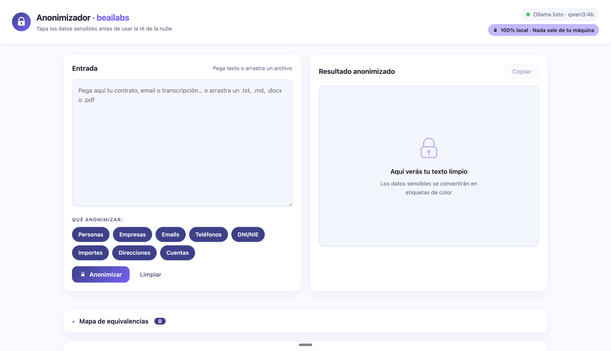

# Anonimizador · beailabs

> Tapa los datos sensibles de tus textos **antes** de pegarlos en ChatGPT.
> Todo ocurre en tu ordenador con **Ollama**: cero APIs externas, cero CDNs, cero datos fuera.

Pegas un email, contrato o transcripción (o arrastras un `.txt`, `.md`, `.docx` o `.pdf`),
pulsas **Anonimizar** y obtienes el mismo texto con los datos sensibles convertidos en
marcadores de color. Lo ll
evas a ChatGPT, trabajas con él, y al volver pegas la respuesta
en **Des-anonimizar** para recuperar los valores reales.



## Qué detecta

| Categoría | Qué reconoce | Marcador |
|---|---|---|
| Personas | Nombres y apellidos | `[PERSONA_1]` |
| Empresas | Nombres de empresas y organizaciones, con o sin forma jurídica (S.L., S.A.…) | `[EMPRESA_1]` |
| Emails | Cualquier dirección de correo | `[EMAIL_1]` |
| Teléfonos | Formato español, con o sin prefijo +34 y separadores | `[TELEFONO_1]` |
| DNI / NIE | 8 dígitos + letra o X/Y/Z + 7 dígitos + letra; admite puntos y guiones | `[DNI_1]` |
| CIF | NIF de empresa: letra + 7 dígitos + control (dígito o letra), con guion, puntos o prefijo ES | `[CIF_1]` |
| Importes | Cantidades con €, EUR o formato de miles español (1.500,00) | `[IMPORTE_1]` |
| Direcciones | Tipo de vía + número, con o sin piso, código postal y ciudad | `[DIRECCION_1]` |
| IBAN / cuentas | IBAN completo o parcial y cuentas de 20 dígitos | `[CUENTA_1]` |

- La misma entidad repetida recibe **siempre el mismo marcador**.
- Una fila de chips permite **elegir qué categorías** se anonimizan en cada uso
  (por defecto todas menos importes). Lo desmarcado se deja intacto.
- El mapa marcador → valor original se muestra en una **tabla plegable** y vive solo
  en la pestaña del navegador.

## Cómo funciona

1. **Regex primero** para los patrones fijos (emails, teléfonos, DNI/NIE, IBAN, importes):
   determinista y fiable.
2. **Modelo local** (`qwen3:4b` vía Ollama) para lo que el regex no puede: personas,
   empresas y direcciones. Responde solo JSON, se valida, y si viene mal se reintenta una
   vez; si vuelve a fallar verás un error claro, nunca un texto a medio anonimizar.
3. **Respaldo determinista** tras el modelo: empresas con forma jurídica (S.L., S.A.,
   S.Coop.…) y domicilios con tipo de vía + número, por si el modelo deja escapar alguno.

## Requisitos

- **Python 3.10+**
- **Ollama** instalado y arrancado:

  ```bash
  brew install ollama   # macOS · en Linux/Windows: https://ollama.com/download
  ollama serve          # o abre la app de Ollama
  ```

  El modelo no hace falta bajarlo a mano: lo descarga el script de arranque.

## Arrancar

```bash
./run.sh
```

El script crea el entorno virtual, instala las dependencias, descarga `qwen3:4b` si falta
(~2,5 GB, solo la primera vez) y abre <http://localhost:8000> en tu navegador.

Si Ollama no está arrancado, la app carga igual y te lo avisa en la esquina superior
derecha; arráncalo y vuelve a lanzar `./run.sh`.

> ¿Otro modelo? `ANON_MODEL=llama3.2:1b ./run.sh` (más rápido, menos preciso).
> El script está probado en macOS y Linux; en Windows, usa WSL.

## Cómo se usa

1. **Pega texto** o arrastra un archivo. El texto extraído aparece para que lo revises
   antes de anonimizar. Los PDF escaneados sin capa de texto se avisan (no se hace OCR).
2. **Marca o desmarca** las categorías en "Qué anonimizar".
3. Pulsa **Anonimizar** y copia el resultado con el botón **Copiar**.
4. Trabaja con el texto en ChatGPT (o donde quieras).
5. Pega la respuesta en **Des-anonimizar** para recuperar los valores reales.

## Estructura

```
backend/app.py        API FastAPI · sirve el frontend · proxy a Ollama
backend/extract.py    Extracción local de .txt / .md / .docx / .pdf
backend/anonymize.py  Regex + orquestación del modelo + deduplicación
static/               Frontend vanilla (HTML/CSS/JS, sin CDNs)
run.sh                Arranque: venv + dependencias + modelo + servidor
```

## Privacidad

- El servidor escucha solo en `127.0.0.1`. La app no hace ninguna llamada a Internet.
- Los archivos se procesan en memoria y se descartan: nada se escribe en disco.
- El texto original no se guarda ni se registra en logs; desaparece al cerrar la pestaña.

## Licencia

MIT. Úsalo, modifícalo y compártelo libremente.

---

### Hecho por beailabs

IA práctica y sin humo, explicada para que la uses de verdad.

▶️ **YouTube — [@beailabs_tech](https://www.youtube.com/@beailabs_tech)**

_Si te ha sido útil, deja una ⭐ en el repo y suscríbete al canal._
